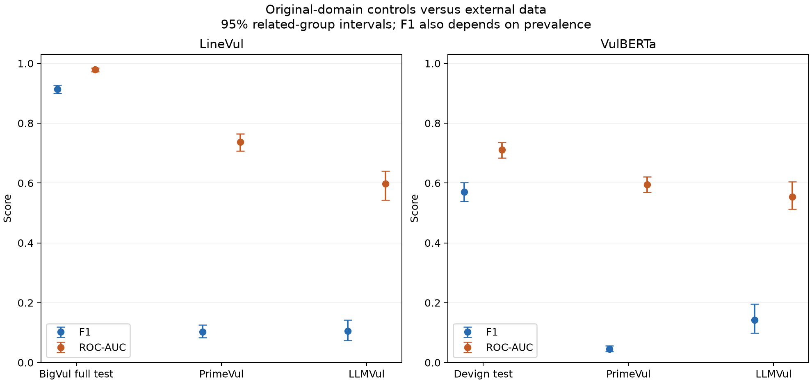

# RQ1 diagnostics: priority-five results

October 31, 2026. **The original-domain controls, documented training-overlap audit, matched-cohort analyses and grouped uncertainty estimates are complete.** Independent label adjudication from Priority 4 remains pending; pretraining exposure and the original converted-checkpoint training history are not fully auditable.

**Finding:** the checkpoints reproduce their original benchmark results, but transfer poorly. The gap persists after controlling observable language, length and prevalence, screening damaged/truncated inputs, and excluding detected fine-tuning overlap. VulBERTa’s ranking also degrades on unfamiliar commits within Devign itself. This supports limited transfer as a major explanation for low F1. It does not identify syntax differences, AI authorship, or label error as a single causal explanation.

Verification passed: **790 checks and 7 focused tests**, including independent scikit-learn point metrics, matching balance, source split membership, all overlap counts, preserved historical inputs, and an independent replication of the 2,000-draw Devign confidence intervals.

## 1. Original-domain controls

| Model / dataset | N / positives | Prevalence | Precision | Recall | F1 | F1 95% interval | ROC-AUC | AP |
| --- | ---: | ---: | ---: | ---: | ---: | --- | ---: | ---: |
| LineVul / BigVul full test | 18,864 / 1,055 | 5.59% | 97.12% | 86.35% | 91.42% | 90.05%–92.72% | 0.979 | 0.934 |
| VulBERTa / Devign test | 2,732 / 1,255 | 45.94% | 64.84% | 50.84% | 56.99% | 53.82%–60.17% | 0.711 | 0.690 |
| LineVul / PrimeVul | 24,788 / 549 | 2.21% | 6.77% | 21.68% | 10.32% | 8.39%–12.55% | 0.737 | 0.056 |
| VulBERTa / PrimeVul | 24,788 / 549 | 2.21% | 2.45% | 31.88% | 4.55% | 3.66%–5.60% | 0.595 | 0.025 |
| LineVul / LLMVul | 18,751 / 1,540 | 8.21% | 8.72% | 13.18% | 10.49% | 7.37%–14.25% | 0.597 | 0.103 |
| VulBERTa / LLMVul | 18,751 / 1,540 | 8.21% | 8.83% | 37.01% | 14.26% | 9.81%–19.61% | 0.553 | 0.085 |
| LineVul / CWEval | 58 / 29 | 50.00% | 0.00% | 0.00% | 0.00% | 0.00%–0.00% | 0.436 | 0.469 |
| VulBERTa / CWEval | 58 / 29 | 50.00% | 52.94% | 62.07% | 57.14% | 45.61%–66.67% | 0.571 | 0.624 |

Precision is displayed as zero when no functions are predicted vulnerable; undefined precision bootstrap draws are recorded separately. AP is average precision and should be interpreted against each dataset’s prevalence. These control runs add new evidence; the seven original RQ1 results and their thresholds remain unchanged.

LineVul used all **18,864** functions in the official test CSV. All **2,000** earlier sample probabilities and predictions matched exactly, both in the preliminary parity check and embedded in the full run. Its full-test confusion matrix is **TN 17,782 / FP 27 / FN 144 / TP 911**.

VulBERTa used the official CodeXGLUE **2,732-row Devign test split**, with **1,255 positives**, after passing parity on 64 existing PrimeVul/LLMVul examples (maximum score difference 0). Its confusion matrix is **TN 1,131 / FP 346 / FN 617 / TP 638**. The pinned conversion’s model card reports 56.93% F1; this run measures 56.99%. The run uses the previously audited explicit author cleaner and local Clang adaptation; it is not a byte-for-byte reproduction of the author’s original environment.

Both evaluations retain frozen weights, class 1 = vulnerable, strict `p > 0.5`, batch 16, seed 42, and the existing 512/1,024-token limits. No fitting, calibration, threshold selection or new checkpoint selection occurred.

The [pinned VulBERTa model card](https://huggingface.co/claudios/VulBERTa-MLP-Devign/blob/fecabdee24a3ef6e804d7629d6eed03dc6b4f61e/README.md) identifies an unofficial conversion fine-tuned on CodeXGLUE Devign. The [CodeXGLUE split](https://github.com/microsoft/CodeXGLUE/tree/ac74a62802a0dd159b3258c78a2df8ad36cdf2b9/Code-Code/Defect-detection) has 21,854 train / 2,732 validation / 2,732 test rows. The author’s [fine-tuning notebook](https://github.com/ICL-ml4csec/VulBERTa/blob/75ab355bf8be124751084c0ff3563df24f48fe38/Finetuning_VulBERTa-MLP.ipynb) uses train/validation indices, with test indices in a separate evaluation notebook. LineVul’s [published implementation](https://github.com/awsm-research/LineVul/tree/9401ec6e60b762a9308645961268203244bee048) saves its best validation-F1 checkpoint. These records support the intended protocol; they do not prove the actual converted checkpoint’s complete history. The author’s separate OneDrive bundle was not verified.

## 2. Training overlap and control limitations

Downloaded and hashed the officially linked BigVul training (**150,908**) and validation (**18,864**) rows, plus all Devign splits. Original row indices are unique within each split and disjoint between splits. Code overlap nevertheless exists. The following exclusions combine each checkpoint’s own train and validation sets; counts are unions, not sums.

| Model / control | Exclusion screen | Removed rows / positives | Remaining N | F1 | ROC-AUC |
| --- | --- | ---: | ---: | ---: | ---: |
| LineVul / BigVul full test | Exact text | 3 / 3 | 18,861 | 91.56% | 0.979 |
| LineVul / BigVul full test | Same tokens; comments/whitespace removed | 543 / 131 | 18,321 | 92.00% | 0.979 |
| LineVul / BigVul full test | Identifier-normalized candidates | 4,089 / 195 | 14,775 | 92.79% | 0.980 |
| VulBERTa / Devign test | Exact text | 5 / 2 | 2,727 | 57.05% | 0.712 |
| VulBERTa / Devign test | Same tokens; comments/whitespace removed | 15 / 8 | 2,717 | 57.16% | 0.714 |
| VulBERTa / Devign test | Identifier-normalized candidates | 168 / 61 | 2,564 | 57.12% | 0.704 |

The token screen preserves operators and literal values. Identifier normalization can erase meaningful API/variable differences, so its matches are **candidates**, not established semantic duplicates. No exhaustive edited-clone, semantic-clone or pretraining audit was performed. Exact matches include opposite-label cases: all three BigVul test functions with exact training matches, and four Devign test functions with exact training matches, have a conflicting training label.

More importantly, **all 18,864 BigVul test rows belong to training projects**, and **18,779 share a training commit**. Devign also uses the same two projects, FFmpeg and QEMU; **1,777/2,732** test rows share a training commit. Thus these are reproduction controls within familiar source distributions, not project-held-out generalization tests. Grouped intervals account for dependence inside the evaluated set; they do not repair training/test provenance overlap or rule out dataset shortcuts.

| Control | Known commit absent from both train and validation | Positives | F1 | Recall | ROC-AUC / 95% interval |
| --- | ---: | ---: | ---: | ---: | --- |
| BigVul full test | 15 | 14 | 100.00% | 100.00% | 1.000 / too few groups |
| Devign test | 914 | 502 | 50.39% | 44.62% | 0.543 / 0.505–0.580 |

**VulBERTa’s Devign AUC drops from 0.711 overall to 0.543 on the 914 functions with commits absent from both train and validation.** Their positive prevalence is 54.92%, so the 50.39% F1 should not be mistaken for strong discrimination. This observational result is consistent with dependence on familiar commit/source patterns; it does not prove memorization. BigVul has only 15 such known-commit examples, including just one negative: its perfect scores on this tiny subset cannot establish generalization.

No test rows in either control come from projects absent from its train/validation data. Missing commit IDs are kept separate. Single-class commit slices have no category-level precision/F1 claim.

External overlap was also checked. See `overlap_summary.json` for all 20 evaluation/source comparisons and `overlap_sensitivity` in the summary for resulting scores. Cross-source matches are not automatically training exposure for the other checkpoint.

## 3. Comparable cohorts

For each model, match its original-domain control, PrimeVul and LLMVul on **language × source-line bin × binary label**. The bins are 1–10, 11–25, 26–50, 51–100 and 101+ lines. Each shared cell receives the smallest count among the three datasets; a row receives that mass divided by its dataset’s cell count. This exactly balances these observed cells and prevalence without using model scores. Unknown languages and unsupported cells are excluded, with every membership and weight saved.

“Intact” means one parsed function, no source parse error, no model truncation, and, for VulBERTa, unchanged lexical tokens after cleaning. This does not certify runtime completeness or label correctness. “Intact + overlap excluded” additionally removes own train/validation token matches.

| Model / condition | Weighted prevalence | Control F1 / AUC | PrimeVul F1 / AUC | LLMVul F1 / AUC | Retained rows: control / Prime / LLM |
| --- | ---: | --- | --- | --- | --- |
| LineVul / Full inputs | 3.68% | 92.87% / 0.988 | 12.18% / 0.721 | 8.12% / 0.697 | 18,864 / 18,494 / 18,751 |
| LineVul / Intact | 1.64% | 92.44% / 0.982 | 2.98% / 0.479 | 4.27% / 0.528 | 13,978 / 11,064 / 12,317 |
| LineVul / Intact + overlap excluded | 1.64% | 93.02% / 0.982 | 2.96% / 0.480 | 4.27% / 0.528 | 13,655 / 10,805 / 12,314 |
| VulBERTa / Full inputs | 19.95% | 42.67% / 0.744 | 22.58% / 0.561 | 27.72% / 0.571 | 2,732 / 15,073 / 7,392 |
| VulBERTa / Intact | 14.88% | 38.46% / 0.742 | 14.89% / 0.530 | 24.23% / 0.555 | 1,991 / 9,576 / 4,568 |
| VulBERTa / Intact + overlap excluded | 14.96% | 39.12% / 0.748 | 14.95% / 0.529 | 24.32% / 0.555 | 1,976 / 9,560 / 4,568 |

These are conditional descriptive comparisons, not estimates of a causal authorship effect. VulBERTa’s original domain is C-only, so its three-way matched comparison excludes C++ examples. The two model-specific matched cohorts differ and should not be used as a paired comparison between models. A separate external comparison uses identical PrimeVul/LLMVul examples and weights for both models, with paired cluster resampling; it is saved under `paired_external`.

## 4. Metadata, labels and reviewed examples

Language uses an explicit `.c` or C++ file extension where supplied, otherwise the source declaration; it is not inferred from model scores or parser preference. **8,095 BigVul test rows declared C have C++ file extensions.** PrimeVul has **6,294 rows without usable language metadata**, so language matching selects a subset. All original declarations and the chosen language basis are retained.

The slice tables include language, project, length, source labeling method, published review status and LLMVul authorship-signal category. CWE results use **recall among positive examples only**, with support counts; negative functions do not supply a valid denominator for category precision. Categories remain source-supplied and are not independently validated. Devign has no per-function CWE metadata in this source.

Reliable local-versus-cross-function vulnerability judgments are unavailable at population scale, and label evidence differs by dataset. Consequently neither property is claimed to be balanced. Priority 4’s targeted source judgments are carried into the row audit separately; unreviewed rows stay unreviewed. Commit authorship signals do not verify authorship of every function.

| Model / published positive review subset | N | Detected | Recall |
| --- | ---: | ---: | ---: |
| LineVul / all | 83 | 8 | 9.64% |
| LineVul / intact | 30 | 2 | 6.67% |
| LineVul / intact_novel | 30 | 2 | 6.67% |
| VulBERTa / all | 83 | 34 | 40.96% |
| VulBERTa / intact | 55 | 23 | 41.82% |
| VulBERTa / intact_novel | 55 | 23 | 41.82% |

These are exact-code matches where both published LLMVul raters agreed positive. The source sample is enriched for positives, so these figures support recall observations only—not overall F1 or a population label-error rate. Independent blinded adjudication is still pending.

## 5. Uncertainty and what the evidence establishes

All main controls, external results and matched comparisons use 2,000 cluster-bootstrap draws with recorded seeds derived from 20261031. Connected components keep token-identical variants, shared commits/CVEs, and supplied CWEval task families together. Project clustering is additionally reported for full cohorts. Draws with undefined metrics are counted explicitly; zero-prediction precision draws are undefined. The same draws and row weights are used for paired model differences. Matched intervals hold the observed matching weights fixed and therefore condition on the chosen common support. Devign has only two project clusters: its project interval is a descriptive sensitivity, not reliable cross-project uncertainty.

The strongest current explanation is **limited transfer across source and labeling distributions, amplified by low positive prevalence**. Successful original-domain controls make a universal broken binary-classification path less plausible. Those controls use familiar projects and commits, which limits how far their scores generalize. The remaining gaps on balanced, intact, overlap-screened examples are not explained by the measured input defects, direct duplicates or prevalence alone.

Syntax/style differences may contribute, but this analysis does not isolate them. Project/API conventions, vulnerability families, missing runtime context, label definitions, source selection and unmeasured pretraining exposure remain competing explanations. The pending independent review prevents assigning a population fraction of errors to incorrect labels.

## Artifacts and reproduction

Run directory: `localScripts/results/rq1_priority5_20261031/`. Key files: `analysis_plan.json`, `preserved_inputs.json`, `inputs/manifest.json`, model `manifest.json`/`parity.json`/`predictions.jsonl`, `checkpoint_selection.json`, `overlap_summary.json`, `domain_exposure.json`, `joined_evaluation.jsonl`, `matched_membership.csv`, `matched_cells.json`, `slice_metrics.csv`, `metadata_coverage.csv`, `bootstrap/`, `summary.json`, and `verification.json`. Download manifests record source URLs, bytes and SHA-256. Large inputs/results remain in the ignored local results directory.

The tracked implementation is split into `rq1_priority5_sources.py`, `rq1_priority5_controls.py`, `rq1_priority5_profiles.py`, `rq1_priority5_analysis.py`, `rq1_priority5_verify.py`, and this report generator. See the localScripts README for execution order. Re-running inference verifies hashes and reuses a completed run; it does not select or alter a checkpoint.
