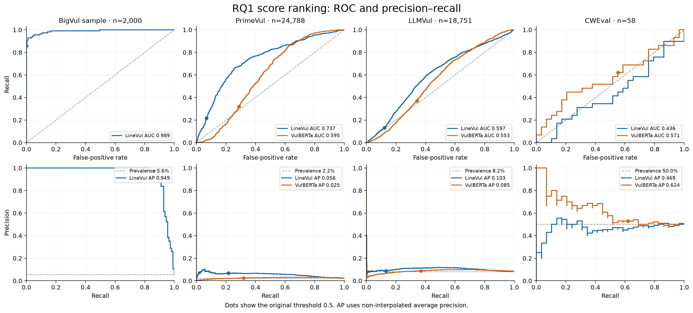
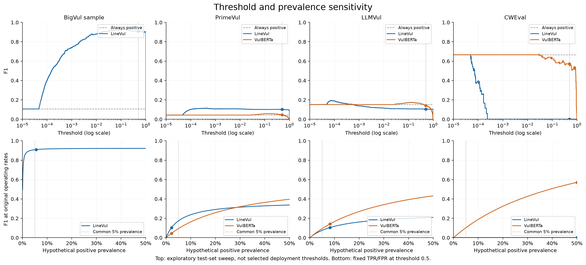
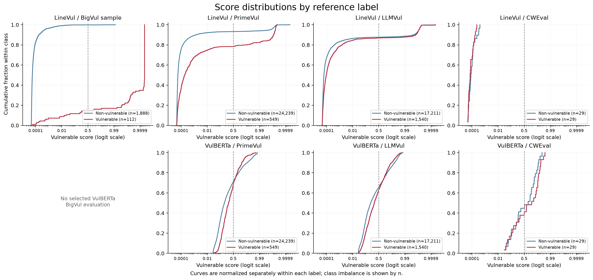
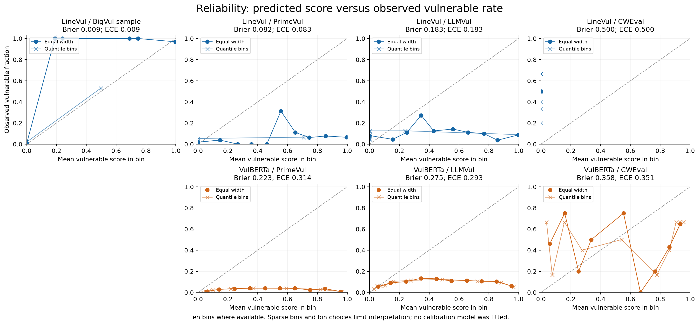
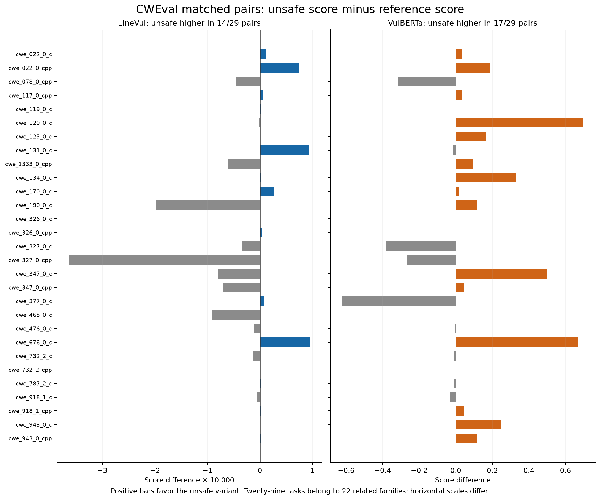

# RQ1 diagnostics: priority-three results

Completed October 29, 2026. Scope: score ranking, threshold behavior, prevalence sensitivity, and probability reliability for the seven frozen RQ1 jobs. This follows [priority 1](../evaluation_validation/rq1_diagnostics.md) and [priority 2](../input_preprocessing/rq1_priority2_diagnostics.md). All results measure agreement with the supplied dataset labels, whose validity remains a separate investigation.

## Finding

**Low F1 is not primarily a binary-evaluation implementation error or a threshold problem alone.** The score analysis shows limited ranking on the external datasets, substantial mismatch between scores and observed label frequencies, and a strong mathematical effect of low positive prevalence.

- **LineVul / PrimeVul:** there is useful ranking signal (ROC AUC 0.737), but average precision is only 5.56%. Even choosing the best threshold on the test set raises F1 only from 10.32% to 11.52%, while increasing the false-positive rate from 6.76% to 12.79%.
- **Both models / LLMVul:** ranking is weak (AUC 0.597 and 0.553). Exploratory threshold changes improve F1, but the best settings flag 40.94% and 58.86% of labeled negatives. They do not produce reliable separation.
- **VulBERTa / PrimeVul:** AUC 0.595 and average precision 2.49% offer little improvement over the dataset's 2.21% positive prevalence. The best exploratory F1 is 5.91%, with a 52.33% false-positive rate.
- **LineVul / CWEval:** the zero F1 at 0.5 does not conceal strong ranking below 0.5. AUC is 0.436, and the best test-set F1 is exactly the 66.67% always-positive baseline. Within matched pairs, unsafe code receives the higher score in only 14/29 cases.
- **Prevalence matters:** holding each model's original TPR/FPR fixed and standardizing to 5% positives gives VulBERTa F1 of 9.40% on PrimeVul and 9.41% on LLMVul. Much of its observed 4.55% versus 14.26% difference disappears under this analytical comparison.

These are demonstrated properties of the frozen scores and labels. They do not determine whether the remaining ranking limitation originates in source labels, missing context, dataset construction, or checkpoint transfer. Priority 2 showed real preprocessing damage but no aggregate F1 improvement from the tested correction. Priority 4 is now needed to assess source-label evidence.

## Ranking and uncertainty

Average precision (AP) uses the non-interpolated estimator: the sum of recall increments multiplied by precision at each score boundary. It is not trapezoidal PR area. Positive prevalence is the no-skill reference shown in the plots. The implementation was checked against [scikit-learn's AP definition](https://scikit-learn.org/stable/modules/generated/sklearn.metrics.average_precision_score.html).

Intervals below are 95% percentile intervals from 2,000 resamples of related-source groups. They preserve duplicates, source-commit/CVE relationships, and CWEval families. AP and F1 are percentages; ROC AUC is on the 0–1 scale. Full intervals for every metric and project-group sensitivity are in the [machine-readable summary](rq1_priority3_summary.json).

| Model / dataset | ROC AUC [95% interval] | AP % [95% interval] | F1 at 0.5, % [95% interval] |
| --- | --- | --- | --- |
| LineVul / BigVul sample | 0.989 [0.978, 0.997] | 94.95 [91.52, 97.84] | 91.00 [86.64, 94.74] |
| LineVul / PrimeVul | 0.737 [0.707, 0.764] | 5.56 [4.71, 6.78] | 10.32 [8.45, 12.52] |
| VulBERTa / PrimeVul | 0.595 [0.568, 0.620] | 2.49 [2.10, 2.99] | 4.55 [3.67, 5.58] |
| LineVul / LLMVul | 0.597 [0.546, 0.641] | 10.27 [7.92, 13.23] | 10.49 [7.37, 14.08] |
| VulBERTa / LLMVul | 0.553 [0.511, 0.603] | 8.55 [5.66, 12.53] | 14.26 [9.90, 19.48] |
| LineVul / CWEval | 0.436 [0.317, 0.554] | 46.90 [41.72, 58.44] | 0.00 [0.00, 0.00] |
| VulBERTa / CWEval | 0.571 [0.487, 0.672] | 62.42 [53.99, 73.55] | 57.14 [45.28, 66.67] |

The AP/prevalence ratios are 2.51 for LineVul/PrimeVul, 1.13 for VulBERTa/PrimeVul, 1.25 for LineVul/LLMVul, and 1.04 for VulBERTa/LLMVul. The last ratio has a group-bootstrap interval of **0.95–1.18**, so its precision–recall advantage over the prevalence reference is uncertain under this resampling scheme. These ratios use each resample's prevalence rather than comparing an AP interval against a fixed prevalence point estimate.

LineVul's PrimeVul AUC is meaningfully above chance, but that global ordering is not equivalent to high precision at rare-positive operating points. Its BigVul sample remains the strong control. VulBERTa's original-domain Devign control has not yet been run.



[Vector PDF](rq1_priority3_figures/ranking.pdf). Dots mark the original threshold; no precision dot is shown when no positives are predicted.

## Original operating point and baselines

Rates below are percentages; MCC is on the −1 to 1 scale. Recall is TPR. Every confusion matrix matches the original RQ1 result.

| Model / dataset | Prevalence | Precision | Recall | FPR | Predicted positive | Balanced accuracy | MCC |
| --- | ---: | ---: | ---: | ---: | ---: | ---: | ---: |
| LineVul / BigVul sample | 5.60 | 96.97 | 85.71 | 0.16 | 4.95 | 92.78 | 0.907 |
| LineVul / PrimeVul | 2.21 | 6.77 | 21.68 | 6.76 | 7.09 | 57.46 | 0.086 |
| VulBERTa / PrimeVul | 2.21 | 2.45 | 31.88 | 28.74 | 28.81 | 51.57 | 0.010 |
| LineVul / LLMVul | 8.21 | 8.72 | 13.18 | 12.35 | 12.42 | 50.41 | 0.007 |
| VulBERTa / LLMVul | 8.21 | 8.83 | 37.01 | 34.18 | 34.41 | 51.42 | 0.016 |
| LineVul / CWEval | 50.00 | Undefined* | 0.00 | 0.00 | 0.00 | 50.00 | 0.000 |
| VulBERTa / CWEval | 50.00 | 52.94 | 62.07 | 55.17 | 58.62 | 53.45 | 0.070 |

*Zero predicted positives makes precision undefined; stored numerical summaries use zero by convention.*

Always-negative predictions have zero positive-class F1 and 50% balanced accuracy. Always-positive predictions have 100% recall, precision equal to prevalence, and F1 of **10.61% on BigVul, 4.33% on PrimeVul, 15.18% on LLMVul, and 66.67% on CWEval**. Both original LLMVul scores and both CWEval scores fall below their always-positive F1 baseline. That baseline is a diagnostic reference, not a proposed detector.

## What threshold changes can and cannot do

The sweep evaluates every distinct score boundary using the original strict `score > threshold` rule, plus a fixed threshold grid. Tied scores remain together. If several thresholds attain the same maximum, the largest threshold is reported. Displayed thresholds are rounded; the CSV retains full precision.

**These maxima were selected on the test labels. They are optimistic descriptive bounds for these fixed score orderings, not validated performance or recommended thresholds.** No threshold, calibration model, or checkpoint was changed.

| Model / dataset | Original F1 | Best exploratory F1 | Threshold, approximately | Precision there | Recall there | FPR there |
| --- | ---: | ---: | ---: | ---: | ---: | ---: |
| LineVul / BigVul sample | 91.00% | 92.52% | 0.189558 | 97.06% | 88.39% | 0.16% |
| LineVul / PrimeVul | 10.32% | 11.52% | 0.000445771 | 6.71% | 40.62% | 12.79% |
| VulBERTa / PrimeVul | 4.55% | 5.91% | 0.153688 | 3.08% | 73.41% | 52.33% |
| LineVul / LLMVul | 10.49% | 19.45% | 0.0000740480 | 11.60% | 60.06% | 40.94% |
| VulBERTa / LLMVul | 14.26% | 17.50% | 0.124097 | 9.95% | 72.66% | 58.86% |
| LineVul / CWEval | 0.00% | 66.67% | 0.0000490852 | 50.00% | 100.00% | 100.00% |
| VulBERTa / CWEval | 57.14% | 67.44% | 0.0289107 | 50.88% | 100.00% | 96.55% |

LineVul's LLMVul F1 can rise substantially by labeling far more examples positive, but precision remains only 11.60%. The CWEval optima label all 58 functions positive for LineVul and 57/58 positive for VulBERTa. Neither is evidence of a useful threshold remedy.

Low-false-positive-rate recall is another view of the ranking limitation. These are the maximum empirically attainable recalls at or below each budget, with no interpolation or splitting of tied scores. Their thresholds are also exploratory.

| Model / dataset | Recall at FPR ≤1% | Recall at FPR ≤5% | Recall at FPR ≤10% |
| --- | ---: | ---: | ---: |
| LineVul / BigVul sample | 91.07% | 94.64% | 96.43% |
| LineVul / PrimeVul | 4.74% | 14.75% | 30.78% |
| VulBERTa / PrimeVul | 0.00% | 0.91% | 3.28% |
| LineVul / LLMVul | 0.97% | 5.06% | 10.97% |
| VulBERTa / LLMVul | 0.45% | 2.47% | 6.30% |
| LineVul / CWEval | 0.00% | 0.00% | 0.00% |
| VulBERTa / CWEval | 6.90% | 13.79% | 20.69% |

With only 29 CWEval negatives, one false positive is 3.45%; its low-FPR estimates have coarse resolution. Group intervals for these recalls are saved in the summary.

## Prevalence contribution

Before computing results, the common positive prevalence was set to **5%**. At fixed original TPR and FPR, precision and F1 were recalculated as:

`precision = π·TPR / [π·TPR + (1−π)·FPR]`

`F1 = 2π·TPR / [π·(1+TPR) + (1−π)·FPR]`

| Model / dataset | Observed F1 | F1 at 5% positives | Precision at 5% positives |
| --- | ---: | ---: | ---: |
| LineVul / BigVul sample | 91.00% | 90.83% | 96.60% |
| LineVul / PrimeVul | 10.32% | 17.33% | 14.44% |
| LineVul / LLMVul | 10.49% | 7.58% | 5.32% |
| VulBERTa / PrimeVul | 4.55% | 9.40% | 5.52% |
| VulBERTa / LLMVul | 14.26% | 9.41% | 5.39% |
| LineVul / CWEval | 0.00% | 0.00% | Undefined* |
| VulBERTa / CWEval | 57.14% | 10.26% | 5.59% |

*The formula's zero denominator is stored as zero by convention; precision remains undefined for all-negative predictions.*

The VulBERTa PrimeVul/LLMVul F1 difference nearly disappears under common prevalence. Conversely, LineVul's similar original F1 values hide worse LLMVul operating rates: at the same prevalence, its PrimeVul F1 is more than twice its LLMVul F1. The original high CWEval F1 for VulBERTa is also strongly assisted by the balanced label distribution.

This isolates a mathematical prevalence effect while holding measured class-conditional rates fixed. It does not rebalance the actual datasets, control their difficulty or label quality, or establish an authorship effect.



[Vector PDF](rq1_priority3_figures/threshold_prevalence.pdf).

## Score distributions and reliability

LineVul's vulnerable-label median score falls from **0.999954 on BigVul** to **0.000188 on PrimeVul**, **0.0000968 on LLMVul**, and **0.0000723 on CWEval**. The corresponding non-vulnerable medians are 0.0000558, 0.0000570, 0.0000632, and 0.0000842. Full min/1st/5th/25th/median/75th/95th/99th/max quantiles by label are recorded for all seven jobs.

The external scores have large reliability discrepancies. For scores in the top [0.9, 1.0] bin:

| Model / dataset | Bin rows | Mean predicted score | Observed positive fraction |
| --- | ---: | ---: | ---: |
| LineVul / BigVul sample | 97 | 99.73% | 96.91% |
| LineVul / PrimeVul | 1,691 | 99.57% | 6.51% |
| LineVul / LLMVul | 2,269 | 99.69% | 8.73% |
| VulBERTa / PrimeVul | 2,691 | 95.73% | 0.82% |
| VulBERTa / LLMVul | 2,617 | 95.25% | 6.08% |

These values show that softmax outputs cannot be interpreted as accurate vulnerability probabilities against these external labels. They do not establish why the scores disagree with the labels.

| Model / dataset | Brier score | Constant-prevalence Brier reference | ECE, 10 equal-width bins | Log loss |
| --- | ---: | ---: | ---: | ---: |
| LineVul / BigVul sample | 0.0088 | 0.0529 | 0.0089 | 0.0524 |
| LineVul / PrimeVul | 0.0821 | 0.0217 | 0.0826 | 0.5796 |
| VulBERTa / PrimeVul | 0.2235 | 0.0217 | 0.3140 | 0.7334 |
| LineVul / LLMVul | 0.1827 | 0.0754 | 0.1830 | 1.3814 |
| VulBERTa / LLMVul | 0.2753 | 0.0754 | 0.2930 | 0.8769 |
| LineVul / CWEval | 0.4999 | 0.2500 | 0.4999 | 4.6954 |
| VulBERTa / CWEval | 0.3576 | 0.2500 | 0.3509 | 1.0784 |

The constant reference uses the observed test prevalence, so it is a descriptive reference rather than a fitted deployment model. Brier score and log loss reflect both discrimination and reliability; neither isolates calibration alone. Reliability curves compare mean score with observed positive frequency, and ECE is the bin-size-weighted absolute difference. Equal-quantile bins are also provided to expose binning sensitivity. These definitions and limitations follow the [scikit-learn calibration documentation](https://scikit-learn.org/stable/modules/calibration).

No calibrator was fitted. Monotonic recalibration can alter the operating threshold and probability scale but cannot create a better score ordering; tie creation can also affect ranking metrics. Any proposed fitted correction requires development data and an untouched evaluation. All labeled LLMVul rows have already been used in RQ1, so a retrospective split would not create a new confirmatory test.



[Distribution PDF](rq1_priority3_figures/score_distributions.pdf). Each class's cumulative distribution is normalized separately; the horizontal axis is a logit scale.



[Reliability PDF](rq1_priority3_figures/reliability.pdf). Sparse bins, particularly in CWEval and intermediate BigVul scores, should not be interpreted as precise calibration estimates. The underlying bin counts are saved.

## CWEval matched pairs

All 29 task pairs were aligned by task ID and checked for one reference label 0 and one unsafe label 1. The supplied grouping combines them into **22 families**, including related language variants. Exact score ties were checked separately from near ties.

| Measure | LineVul | VulBERTa |
| --- | ---: | ---: |
| Unsafe score higher | 14 / 29 | 17 / 29 |
| Reference score higher | 15 / 29 | 12 / 29 |
| Exact ties | 0 | 0 |
| Both labels correct at 0.5 | 0 / 29 | 5 / 29 |
| Both predicted negative | 29 / 29 | 8 / 29 |
| Both predicted positive | 0 / 29 | 13 / 29 |
| Both labels wrong | 0 / 29 | 3 / 29 |
| Median unsafe-minus-reference score | −0.000000294 | +0.014992 |

The family-bootstrap 95% intervals for the unsafe-higher fraction are **27.59–68.97% for LineVul** and **38.46–79.31% for VulBERTa**. Three LineVul pairs have absolute score differences at most 0.000001; none of the VulBERTa pairs do. Pair ordering and cross-example ROC AUC answer different questions, and both are uncertain on this small set. Neither finding warrants flipping the class mapping.



[Vector PDF](rq1_priority3_figures/cweval_pairs.pdf). The horizontal scales differ; all individual pair scores and deltas are in `cweval_pairs.csv`.

## Grouping, validation, and limits

Related-source groups are connected components linking identical code, nonempty commit URLs, valid CVE identifiers, and supplied CWEval family IDs. Unknown metadata is not treated as a shared group. The project sensitivity additionally links project names. Thus duplicate code can merge nominal projects; these are component counts, not simply counts of distinct project strings.

| Dataset | Rows | Related groups | Largest related group | Project components | Largest project component |
| --- | ---: | ---: | ---: | ---: | ---: |
| BigVul sample | 2,000 | 1,125 | 13 (0.65%) | 151 | 800 (40.00%) |
| PrimeVul | 24,788 | 679 | 869 (3.51%) | 216 | 4,140 (16.70%) |
| LLMVul | 18,751 | 1,514 | 3,431 (18.30%) | 220 | 5,462 (29.13%) |
| CWEval | 58 | 22 | 4 (6.90%) | 22 families* | 4 (6.90%) |

*CWEval has no project field; its project result reuses the family grouping.*

Each bootstrap replicate samples groups with replacement and retains every row within a sampled group. This preserves the original row-weighted estimand, including duplicates. Models on the same dataset use identical draws, allowing paired differences. The base seed is 20261029, with dataset/scheme offsets recorded in the script; each grouping uses 2,000 repetitions. All production resamples contained both labels; undefined-replicate counts were zero. Intervals are exploratory, conditional on the observed source groups and labels, and have no multiple-comparison correction. Unknown dependence and very large clusters remain limitations.

Project clustering broadens some intervals: LineVul/PrimeVul AUC becomes **0.684–0.778**, and its F1 interval becomes **4.24–14.16%**. The paired LineVul-minus-VulBERTa PrimeVul AUC interval remains positive under project grouping (**0.090–0.186**). For LLMVul, paired intervals for AUC, AP, and F1 include zero under both groupings, so a strong model-superiority claim is not supported by this analysis. Cross-dataset overlaps are not pooled as independent observations or used for paired cross-dataset significance claims.

The run reuses **89,194 aligned model–dataset records** covering 45,597 dataset rows. Input files and profile manifests were checked against priority-two hashes. **133 independent metric/boundary checks** passed against scikit-learn, including weighted calculations and strict threshold behavior, and **eight focused unit tests** passed. All original confusion matrices are unchanged. Global threshold maxima, saved curves, group intervals, figure inputs, and artifact hashes were additionally reconciled in the saved verification record.

No inference, training, relabeling, threshold adoption, or calibration fitting was performed. The source-label, historical-provenance, missing-context, and training-overlap limitations from the earlier reports still apply.

## Artifacts and reproduction

- [Summary JSON](rq1_priority3_summary.json): metrics, quantiles, baselines, intervals, paired comparisons, configuration, and hashes.
- [Run directory](rq1_priority3_20261029): frozen analysis plan/scripts; all ROC/PR threshold boundaries; threshold grid; calibration bin counts; prevalence table; group assignments; bootstrap replicates; all CWEval pairs; verification.
- [Figures](rq1_priority3_figures): five inspected figures, each as PNG and vector PDF.
- [Score analysis](../../../localScripts/rq1_priority3_scores.py), [figure renderer](../../../localScripts/rq1_priority3_figures.py), and [tests](../../../localScripts/test_rq1_priority3.py): reusable implementation.

From the repository root, use a new output directory:

```powershell
$rq1Scores = '.\localScripts\results\rq1_priority3_repeat'
.\localScripts\.venv\Scripts\python.exe .\localScripts\rq1_priority3_scores.py --output $rq1Scores
.\localScripts\.venv\Scripts\python.exe .\localScripts\rq1_priority3_figures.py --source $rq1Scores --destination '.\localScripts\reports\rq1_priority3_repeat_figures'
.\localScripts\.venv\Scripts\python.exe -m unittest discover -s localScripts -p test_rq1_priority3.py -v
```

The default source is the verified priority-two run; `--source` can name another compatible verified run. Bootstrap repetitions default to 2,000. The original RQ1 tables and 0.5 decision rule remain unchanged.

**Next: priority 4, source-label and dataset-construction review.** The score evidence establishes limited external discrimination and a prevalence contribution; label evidence is needed to distinguish detector misses from ambiguous or incorrect reference labels.
